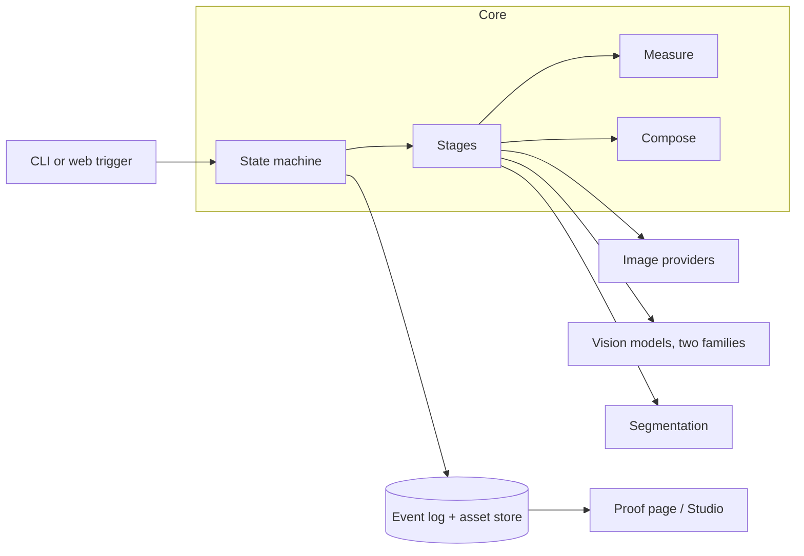

# Architecture

_2026-11-15. Proposed. Implements WORKFLOW.md. Nothing described here is built yet; §9 lists exactly what is and is not connected._

## 1. Principles

1. **Code owns the order of steps; models fill in the steps.** The pipeline is an explicit state machine. Each model call is a stateless function with a typed input, a typed output checked against a schema, and no tools. This is what makes caps, costs and provenance enforceable.
2. **Everything is an immutable record.** Images are stored by content hash and never overwritten. State is an append-only log of events. "Undo" is choosing an earlier record; "compare" is reading two.
3. **Pixels are measured from original files**, never from screenshots. Screenshots are used only to judge layout as displayed.
4. **Providers are replaceable.** No provider's name appears outside its adapter. The model market changes monthly (DISCOVERY §4).
5. **Pipeline first, interface second.** The core is a library with a command-line runner. The web studio is a reader of the same records.

## 2. Shape

```
apps/architectural-color-studio/
  core/        pipeline stages, state machine, schemas, caps
  measure/     colour maths, region statistics, line detection, diffs
  compose/     swatch panel and Plate layouts
  providers/   adapters: image, vision, segmentation
  rubrics/     reviewer instructions and prompts, versioned as files
  data/        palette library, calibration-set manifest
  cli/         run, resume, calibrate, bakeoff, proof
  web/         proof page (Stage 1), studio (Stage 3)
  runs/        local run folders, not committed
```



**Stack.** TypeScript on Node throughout, so the pipeline, the web app and the tests share types. `sharp` for pixel work. SVG rasterised by a deterministic renderer (`resvg`) for the swatch panel, so output does not vary by machine. Playwright with Chromium for phone screenshots; it is already used for the browser checks elsewhere in this repository. Web: Next.js on Vercel, matching the owner's existing hosting. A Python worker was considered for the richer image-science libraries and rejected for now: two runtimes for one person's tool is not worth it unless Stage 0 shows the measurement needs it.

**Running long jobs.** A Plate takes 10–20 minutes across dozens of calls. Stages 0–2 run from the command line: each stage is keyed by a hash of its inputs and writes its result before the next begins, so an interrupted run resumes without repeating paid work. In Stage 3 the same stages run under a durable workflow service on the host. The choice of service is deferred to that stage because nothing in the core depends on it.

## 3. Records

Stored first as files in a run folder (`events.jsonl`, `assets/<hash>.png`, JSON records), later indexed in a database without changing their shape.

| Record | Holds |
|---|---|
| **Palette** | Source and number, colours with names and sRGB values, licence note |
| **Brief** | Palette, room type, mood, audience, formats, constraints, reference asset hashes, autonomy mode, spending cap |
| **Concept** | The three directions, the pairwise votes, the one chosen |
| **RoomPlan** | Dimensions, openings, furniture with sizes and positions, routes, light, camera, material schedule (surface → palette colour → target share), neutral object, traces of life |
| **Asset** | Content hash, kind, dimensions, colour profile, parent asset, and how it was made: provider, model version, full prompt, parameters, seed, reference inputs, cost, duration |
| **Measurement** | Asset, region mask hash, mask quality, statistic, target, differences, method version; or "not run" with reason |
| **Finding** | Seat, model, rubric version, asset, region box, kind (measured / observed / inferred), severity, statement, implied fix, confidence, confirmation result |
| **Comparison** | Two assets, both orders, verdicts |
| **Adjudication** | Findings accepted, dropped and overruled with reasons; the revision brief |
| **Plate** | Champion asset, swatch panel asset, composed formats, confidence band with reasons |
| **Decision** | Who, when, approve / revise / reject, the proof shown, any note |
| **Event** | Timestamped, append-only: every stage start, result, retry, cap and cost |

Prompt provenance and the revision trail are not separate features. They fall out of `Asset.parent` and the event log.

## 4. Provider interfaces

```ts
interface ImageProvider {
  capabilities: { maxPixels: number; aspectRatios: string[]; maskedEdit: boolean;
                  referenceImages: number; seed: boolean };
  generate(req: { prompt: string; aspect: string; references?: AssetRef[]; seed?: number }): Promise<Generated>;
  edit(req: { image: AssetRef; instruction: string; mask?: AssetRef; references?: AssetRef[] }): Promise<Generated>;
}

interface VisionModel {            // reviewers, confirmer, adjudicator
  family: string;                  // used to enforce cross-family confirmation
  ask<T>(req: { instructions: string; images: AssetRef[]; schema: Schema<T> }): Promise<T>;
}

interface Segmenter {
  segment(req: { image: AssetRef; surfaces: string[] }): Promise<{ surface: string; mask: AssetRef; score: number }[]>;
}

type Generated = { asset: AssetRef; model: string; cost: Usd; raw: unknown };
```

A pipeline run needs at least one image provider and two vision families. If only one vision family is connected, cross-family confirmation is reported as **not run** and confidence cannot be High. Stage 0 decides which providers; DISCOVERY §4 lists the candidates.

## 5. Colour and measurement

- **Working assumption:** images are sRGB. Provider files arrive untagged (verified on the reference images). They are treated as sRGB, and that assumption is printed in every proof. Exports are tagged with an sRGB profile.
- **Difference:** CIEDE2000 in CIELAB (D65), with hue-angle and chroma differences reported separately because they diagnose different causes. The implementation is tested against the published CIEDE2000 reference pairs.
- **Regions, not points.** A segmentation model finds each surface named in the room plan. The statistic is the median of pixels between the 25th and 75th lightness percentiles in the region: the lit midtone, excluding shadow and highlight.
- **Mask quality.** A region is used only if the segmenter's score is high, it is large enough, and its colours form one cluster. Otherwise the measurement is "not run". A bad mask must never produce a confident number.
- **Cast.** The room plan places a known neutral (white trim, a plaster ceiling, a linen shade). Its measured tint estimates the scene's cast. This is an estimate from a generated object, labelled as such; it supports diagnosis, not correction.
- **Grade.** Performed in a perceptual colour space: hue and chroma inside the mask move toward the target, lightness is untouched, edges are feathered. The size of the shift is capped and recorded.
- **Swatch panel.** Chips are filled with the exact sRGB value. Texture is a lightness-only layer with zero mean, so a chip's average remains the target. The gate reads the exported file.
- **Not handled, and said so:** wide-gamut and HDR displays, each platform's recompression (approximated by one JPEG round trip), ambient light where the phone is held, and any relation to physical paint.

## 6. Screenshot and visual evaluation

| Purpose | Input | Tool |
|---|---|---|
| Colour, proportion, lines, diffs | Original image files | `measure/` |
| Layout as seen on a phone | Composed Plate placed in a phone-width page, captured at device pixel ratio 3 | Playwright |
| Thumbnail test | Plate downscaled to 150 px | `sharp`, then the social editor |
| Type legibility | Rendered text boxes from the composition, scaled to phone width | Computed from layout, checked on the screenshot |
| Before and after | Two assets, aligned | Difference map outside the edit mask; side-by-side for reviewers and the proof |

Platform dimensions and interface zones are configuration with a "last verified" date, because platforms change them.

## 7. Cost

All figures are estimates from third-party price pages (DISCOVERY §4) and assumed call counts. Stage 0 replaces them with measured numbers; the event log records the real cost of every call from then on.

| Step | Calls per Plate | Estimated cost |
|---|---|---|
| Concept, plan, plan review, adjudication (text) | about 12 | $0.15–0.50 |
| Candidates, round 1 | 4 images | $0.15–0.50 |
| Segmentation | 4–8 | $0.05–0.20 |
| Panel, comparisons, confirmations | about 20 vision calls | $0.20–1.00 |
| Each revision round (up to 2) | 1–2 edits, re-measure, partial panel | $0.15–0.65 |
| **Plate, no revision needed** | | **about $0.60–2.20** |
| **Plate, two revision rounds** | | **about $1–3.50** |

- **Hard cap per Plate**, checked before every paid call; default proposed at $5. Reaching it is an escalation, not a silent stop.
- **Monthly ceiling** across all runs, set by the owner.
- **Thirty Plates a month** is therefore roughly $20–100 in model costs. Hosting and storage are small at this scale.
- Cost levers, in order: fewer candidates per round, a cheaper model for the triage scan, batch pricing for overnight series where a provider offers it.
- The honest unit is **cost per approved Plate**, which includes everything spent on rejected ones. The roadmap tracks it.

## 8. Security and privacy

- **Secrets** live only in server-side environment variables. The CLI reads them from the environment; `.env` files are ignored by git; a secret scan runs before every commit. No key is ever sent to the browser or written to a record.
- **The browser never calls a provider.** All model calls happen server-side.
- **Uploads are data.** Text inside a reference image or a brief is never treated as an instruction to the pipeline. Reviewers have no tools and cannot act; their output is parsed against a schema and anything else is discarded.
- **Third parties see what is sent.** Reference images and prompts go to the chosen providers under their retention terms. The proof lists which providers saw which assets.
- **Private by default.** The studio sits behind sign-in. Asset links are short-lived. Nothing is posted anywhere by the system.
- **Separate from the household.** This project does not use the Calendar Home Hub's database. Where its records live when the web studio arrives is an open decision (STATE.md).
- **Spending** is bounded in code, not by trust in a loop ending.
- **Licences.** The palette data's licence and attribution are stored with the library. Fonts are bundled only under licences that permit it.

## 9. Capability ledger — what is real today

| Capability | Status on 2026-11-15 |
|---|---|
| Colour measurement of an image file against targets | Demonstrated once on the reference images with `research/measure_reference.py`; not yet a library |
| Headless browser screenshots at desktop and phone widths | Demonstrated on the reference site |
| Image generation or editing | **Not connected.** No provider key exists in this project |
| Vision review by any model inside a pipeline | **Not connected** |
| Segmentation | **Not connected; provider not chosen** |
| Swatch rendering, composition, proof page | Not built |
| Any claim about which image model is best for this work | **Unverified** until the Stage 0 bake-off |

This table is updated at every checkpoint. A proof may only cite capabilities marked connected.
