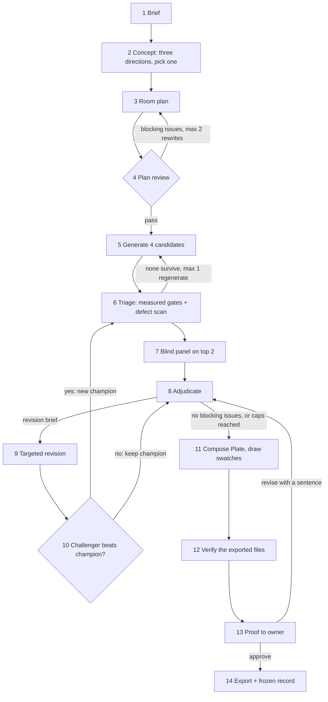

# Workflow — how a Plate is made

_2026-11-15. Proposed. Terms: a **Plate** is the finished room-plus-swatches piece; a **candidate** is one generated room image; the **champion** is the best candidate so far._

## 1. Three architectures considered

| | A. Automated chat loop | B. Plan-first staged pipeline | C. 3D-first |
|---|---|---|---|
| Idea | Do what the reference does by hand: prompt → image → model critique → re-prompt, in a loop | Write and review a room plan, generate several candidates, measure, review blind, revise the champion with targeted edits, compose the Plate from drawn swatches | Build a simple 3D scene from the plan, render exact materials and light, use an image model only to add realism |
| Reliability | Low. Each re-prompt re-rolls the whole image, so fixes break things that were right. Nothing stops endless loops | High. Plan errors caught before spend; a revision replaces the champion only if it wins; fixed caps | Highest for geometry and colour. Lowest for "does it look real" until a large asset library exists |
| Autonomy | Looks autonomous, but needs a person to notice drift | High. Human at brief and final proof only | High once built |
| Quality control | Reviewers and generator share blind spots; critique is unverified | Measured gates, blind reviewers, cross-model confirmation, calibration set | Geometry and albedo are known, not inferred |
| Cost per approved Plate | Unbounded; cheap per step, expensive per success | Estimated $1–4, hard cap per Plate (ARCHITECTURE §7) | Low per image, but high build and upkeep |
| Build effort | Days | Weeks | Months, plus furniture and material assets |
| Main risk | Plausible mediocrity; cannot tell why something failed | More moving parts; segmentation quality limits measurement | Sterile CG look, the exact thing the brief forbids |

**Selected: B.** It is the only one that addresses both failures measured in the reference (plan error, colour drift) with mechanisms rather than hope, and it can be built and proven in stages. A is kept as the baseline that B must beat in Stage 1. C is not discarded: its control over geometry could later serve series consistency (the same room in five palettes), and the room plan B writes is the input C would need. It becomes an experiment only if B's geometry failures remain the main cause of rejection.

Rejected alongside A: a single "creative agent" with tools that decides its own next step. It is attractive and it is how the reference's manual loop feels, but it makes cost, provenance and stopping rules unenforceable. Here the order of steps is code; models fill in each step.

## 2. The pipeline

| # | Stage | What happens | Who |
|---|---|---|---|
| 1 | Brief | Palette, and optionally room type, mood, audience, references, constraints. Missing fields are filled with stated defaults | Owner |
| 2 | Concept | Three short directions that differ in room type, light and where each colour goes. One is chosen by blind pairwise vote against the brief; the others are kept | Art director (model) |
| 3 | Room plan | A structured specification: room size, openings, each piece of furniture with size and position, routes through the room, the light source and its colour temperature, camera position, and a **material schedule** assigning every palette colour to named surfaces with a target share of the frame. Includes a neutral object for cast checking and the planned traces of life | Art director |
| 4 | Plan review | Architect-builder and interior designer review the plan as text. Clearances and scale are computed from the plan's numbers, not judged | Reviewers + code |
| 5 | Generate | Four candidates from the plan, at 9:16. Prompt, model, parameters and seed recorded per candidate. Where two providers are connected, candidates are split between them | Image provider |
| 6 | Triage | Measured gates on every candidate (§5), plus a quick scan for gross defects. Failures are discarded with a recorded reason, not reviewed | Code + one scanner |
| 7 | Blind panel | The top two candidates go to the full panel (§3). Reviewers work alone | Reviewers |
| 8 | Adjudicate | Findings are merged, confirmed, ranked and turned into one revision brief (§4) | Adjudicator |
| 9 | Revise | The mildest tool that fixes the issue (§6) | Provider or code |
| 10 | Champion test | The revision must pass every gate the champion passed and win a blind pairwise comparison. Otherwise it is kept in the record and the champion stands | Code + panel |
| 11 | Compose | Swatch panel drawn from the palette's numbers; diptych and other formats assembled | Code |
| 12 | Verify | The exported files themselves are opened and checked (§5) | Code + social editor |
| 13 | Proof | One page for the owner (VISION §3) | Owner |
| 14 | Export | Files plus the full record, frozen | Code |

## 3. The panel

The brief names six disciplines. All six rubrics are kept. Two changes are proposed: architect and builder share one seat, because from a single image their evidence is the same and a builder's judgment of construction without drawings is largely guesswork; and a seventh instrument, the cold viewer, is added because nothing in the brief tests what an uninformed person actually sees.

| Seat | Sees | Does not see | Asks |
|---|---|---|---|
| **Architect-builder** | The plan, then the image | The palette targets, other reviews | Does the image match the plan? Could each element be built: junctions, reveals, fixings, spans? Is every route clear? Two rubric sections, one for each discipline |
| **Interior designer** | Image, brief | Measurements, other reviews | Hierarchy, scale of furnishings, whether the colours are on the right surfaces, whether the room has a point of view |
| **Stylist** | Image only | Brief, plan, palette | Is it believable and restrained? Lists every repeated object, mirrored pair, and missing trace of life. Also asked cold: "photograph or rendering, and what gave it away?" |
| **Colourist** | Image, palette, the measurement report | Other reviews | Interprets the numbers: is a deviation lighting, material, or a wrong colour? Recommends relight, grade, or regenerate |
| **Social editor** | The composed Plate at phone size and thumbnail size only | The full-size image, everything else | Crop, hierarchy, legibility, whether it stops a scroll |
| **Cold viewer** | The room at phone size, nothing else | Everything | "Name the main colours of this room." "What kind of room is this?" "Would you want to be in it?" Its colour names are compared with the palette by code |
| **Adjudicator** | All findings and measurements | — | §4 |

### How independence is enforced

1. **Blind and parallel.** Reviewers never see each other's findings, the prompt that made the image, the iteration number, or which candidate is the champion.
2. **Different evidence per seat**, as in the table. A reviewer cannot repeat a colleague's point about evidence it was never shown.
3. **Findings, not scores.** Every finding is a record: what, where (a box on the image), severity, the fix it implies, confidence, and its kind: *measured*, *observed*, or *inferred*. "Lovely warm atmosphere" is not a finding and is discarded. Each reviewer must also name one thing to keep, so revisions do not destroy what works.
4. **Ranking by comparison.** Candidates are compared in pairs, each pair shown in both orders. A verdict that flips with the order counts as a tie.
5. **Confirmation by another model family.** A blocking finding triggers a revision only after a second model, from a different provider than the reviewer, answers a narrow yes/no question about it ("Is the sofa in front of the fireplace opening?"). Unconfirmed findings are logged and dropped. This stops an invented defect from driving a loop.
6. **Calibration.** Before the panel is trusted, and again whenever a model changes, each seat reviews a fixed set: professional interior photographs, generated rooms with known defects, and clean images with defects deliberately added. A seat that passes flawed images is rubber-stamping; one that fails real photographs is hallucinating. Each seat's catch rate and false-alarm rate are stored and weight its findings.
7. **No self-review.** The model family that generated an image does not provide the only review of it.

## 4. Adjudication

The adjudicator may not add findings of its own or overrule a measurement. It:

1. Removes duplicates and unconfirmed blocking findings.
2. Ranks what remains in a fixed order of authority:
   1. failed measured gates;
   2. physical impossibilities and visible artifacts;
   3. function and livability;
   4. palette reading;
   5. composition and social presentation;
   6. taste.
3. Resolves conflicts. A lower rank yields to a higher. Within a rank, the brief decides. A genuine conflict of taste the brief does not settle is not argued out: both versions are made and the owner is shown one choice.
4. Writes one revision brief: at most three changes, each with the finding it answers, the tool to use, the region affected, and an explicit list of what must not change.
5. Records every dropped or overruled finding with the reason.

Severity scale: **Blocking** (cannot ship: a failed gate, an impossible object, a blocked route), **Major** (ships only if caps are reached, and is disclosed in the proof), **Minor** (noted, never triggers a revision alone), **Keep**.

## 5. Verification — measured versus judged

| Check | Kind | Method |
|---|---|---|
| Swatch chip colour | Measured | Read pixels of the exported file; compare with target; repeat after a JPEG round trip |
| Surface colour, hue error, cast, lightness order, proportion | Measured | Surfaces found by a segmentation model from the plan's surface names; median of lit midtones per region. Region quality is itself checked; an uncertain mask produces "not measured", never a number |
| Vertical lines | Measured | Line detection on the image |
| Format and safe areas | Measured | Pixel dimensions; important content against platform interface zones |
| Type legibility | Measured | Rendered text size at phone width and contrast ratio against its background |
| Unintended change in a revision | Measured | Difference between versions outside the edited region must stay under a threshold |
| Phone appearance | Observed | Real screenshot of the Plate in a phone-sized frame, shown to the social editor |
| Artifacts, plausibility, life, taste | Observed | Panel findings, confirmed as in §3 |
| Buildability, code-like dimensions | Inferred, advisory | Plan arithmetic plus reviewer opinion; always labelled advisory |

A check that could not run is reported as **not run** with the reason. It never defaults to a pass.

## 6. Revision tools, mildest first

| Problem | Tool | Why |
|---|---|---|
| Colour slightly off on a surface that is otherwise right | **Grade**: shift hue and chroma inside that surface's mask, keeping its light and shadow. Capped in size (limit set in Stage 0); disclosed in the proof | A colourist's ordinary job; touches nothing else |
| A local defect: a merged leg, a cloned cushion, a missing trace of life | **Masked edit** of that region | Preserves the approved remainder |
| Wrong light: cast, no dominant source | **Relight edit** of the whole image, then re-measure everything | Light is global |
| Wrong plan: layout, scale, camera | **Regenerate** from a corrected plan | Cannot be patched |
| Colour too far off for the grade cap | **Regenerate** with corrected lighting direction | A large grade looks painted and ignores bounced light |

## 7. Caps, failure handling and escalation

| Situation | Response |
|---|---|
| Provider error or timeout | Retry with backoff, then the second provider. The step is resumable; nothing is regenerated that already exists |
| Content refusal | Record it, rephrase once, then switch provider |
| No candidate survives triage | One regeneration with the failure reasons fed back; then escalate |
| Reviewer returns malformed or empty output | One retry; then that seat is marked absent in the proof. Never silently counted as approval |
| Reviewers contradict each other | Adjudication order; taste conflicts become an A/B for the owner |
| Revision makes things worse | Champion stands; the attempt is kept in the record |
| Limits | 2 plan rewrites, 4 candidates per round, 1 regeneration per round, **3 rounds per Plate**, a spending cap per Plate, a wall-clock cap |
| Caps reached with blocking issues | **Escalate**: the owner sees the best champion, what is still wrong, and what was tried. Not presented as a finished Plate |
| Caps reached with only major issues | Proof is delivered at Low or Medium confidence with those issues disclosed |

The owner is interrupted mid-run for only two reasons: an escalation, or an A/B on taste. In supervised mode (optional) the owner also approves the concept before generation.

## 8. Confidence

A band, not a percentage, because a percentage would imply a precision that does not exist.

- **High** — all measured gates pass, no major findings remain, panel rankings agreed in both orders, every check ran.
- **Medium** — gates pass, but a major finding is disclosed, or a seat was absent, or a check did not run.
- **Low** — delivered at a cap, or the champion won narrowly, or a measurement was unavailable.

The proof states the reasons for the band in plain sentences and links each to its evidence.

## 9. Learning between Plates

Every owner decision is recorded with the proof it was made on. Approved Plates become house-style references for later generations. Rejections with a reason become additions to the stylist's rubric. Reviewer calibration is re-run when owner decisions repeatedly disagree with a seat. None of this is automatic fine-tuning; it is a growing, inspectable set of examples and rules.
